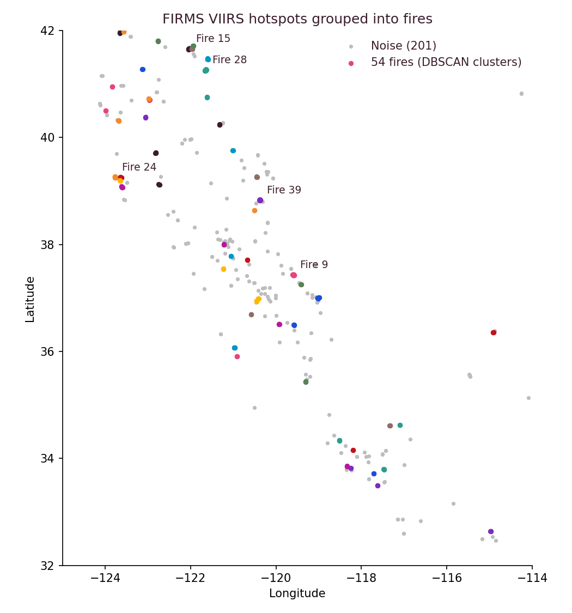
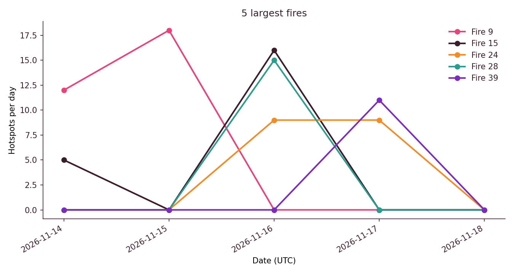

# Wildfire Tracker from Space (NASA FIRMS + DBSCAN)



Groups NASA FIRMS satellite fire hotspots into individual fires with DBSCAN (haversine
distance) and tracks each fire day by day: hotspot count, total fire radiative power (FRP),
centre point, convex-hull area and direction of spread.

**Result (California box `-125,32,-114,42`, 14-18 Nov 2026 UTC, VIIRS NOAA-20):**
499 detections, 487 after dropping low confidence, grouped into **54 fires**
(286 hotspots) plus 201 isolated noise hotspots.

Interactive map: [`outputs/fires_map.html`](outputs/fires_map.html) (download and open in a
browser, or host it with GitHub Pages).

> Learning project. Not an emergency alert tool. For real fire information use official
> sources such as NASA FIRMS, CAL FIRE or InciWeb.

## How it works

- FIRMS publishes active-fire detections from the VIIRS and MODIS instruments, usually within
  ~3 hours of the satellite pass. Each row is one hotspot: latitude, longitude, date, time,
  confidence and FRP (MW, roughly fire intensity).
- One large fire appears as many separate hotspots and nothing says which belong together.
- **DBSCAN** groups points that have at least `min_samples` neighbours within `eps`, links
  such dense points into clusters, and labels isolated points as noise (`-1`). Each cluster
  is treated as one fire.
- Distances are great-circle distances (`metric="haversine"`), which requires coordinates in
  **radians** and `eps` in radians too: `eps = 1.5 km / 6371 km = 2.354e-4 rad`.

```python
coords = np.radians(df[["latitude", "longitude"]])
labels = DBSCAN(eps=1.5 / 6371, min_samples=3, metric="haversine").fit_predict(coords)
```

All days are clustered together, so a fire that grows over several days keeps one ID.

## Parameters

| Parameter | Value | Reason |
|---|---|---|
| `eps` | 1.5 km | about 4 VIIRS pixels (375 m); hotspots of one fire front sit well inside this |
| `min_samples` | 3 | a fire needs at least 3 nearby detections; single hotspots become noise |
| confidence | drop `low` | removes the least reliable detections (12 rows here) |
| days | 5 | most recent 5 UTC dates in the data |

## Results

| Fire | Days active | Hotspots | Total FRP (MW) | Centre (lat, lon) | Spread |
|---|---|---|---|---|---|
| 9 | 2 | 30 | 269.5 | 37.431, -119.592 | 0.15 km |
| 15 | 2 | 21 | 340.9 | 41.657, -122.036 | 0.68 km W |
| 24 | 2 | 18 | 83.9 | 39.259, -123.766 | 0.72 km N |
| 28 | 1 | 15 | 190.7 | 41.257, -121.648 | - |
| 39 | 1 | 11 | 130.7 | 38.830, -120.379 | - |



November is outside California's main fire season: the clusters are small (largest daily
convex hull 4.7 km2) and short-lived (1-3 days). They are consistent with small or managed
burns, but this project cannot tell which; it only groups detections.
Note that the most recent UTC date in the file is usually incomplete, so its counts are low.

Full outputs: `outputs/fires_summary.csv` (one row per fire per day),
`outputs/fires_overview.csv` (one row per fire), `outputs/run_info.json`, `outputs/run_log.txt`.

## Checks performed

- **Radians:** running the same data with `eps=1.5` and no conversion puts every hotspot into
  one giant cluster; with the conversion clusters are tight blobs.
- **No chaining:** the widest cluster spans 3.5 km end to end (median 0.7 km).
- **Noise:** isolated hotspots are labelled `-1` and drawn light grey.
- **Static heat sources:** gas flares and industrial sites show up as a cluster in the same
  place every day with steady intensity. The tracker flags clusters that are seen on every
  day, move < 0.5 km and have a daily-FRP coefficient of variation < 0.5
  (`possible_static_source`). None were flagged in this run, but the rule is a heuristic,
  not a confirmed classification.
- **Cross-check:** compare the largest fires with the
  [FIRMS Fire Map](https://firms.modaps.eosdis.nasa.gov/map/) for the same dates.

## Data source and a deviation from the original plan

- The plan was VIIRS **S-NPP** from the FIRMS area API (needs a free `FIRMS_MAP_KEY`).
- On 18 Nov 2026 the public S-NPP 7-day file contained only a header (no detections), so this
  run uses **VIIRS NOAA-20** (`VIIRS_NOAA20_NRT`): the same instrument type at the same 375 m
  resolution on a sister satellite.
- Without a MAP_KEY the code downloads FIRMS's public 7-day global CSV and filters it to the
  area box; with a key it uses the area API (and falls back to one day per request if the
  API rejects the day range). The key is read from the environment only and never written or
  printed.

## Run it

Windows PowerShell:

```powershell
python -m venv .venv
.\.venv\Scripts\python.exe -m pip install -r requirements.txt
.\.venv\Scripts\python.exe track_fires.py --area -125,32,-114,42 --days 5
```

Options: `--source VIIRS_SNPP_NRT|VIIRS_NOAA20_NRT|VIIRS_NOAA21_NRT`,
`--mode auto|api|public`, `--eps-km`, `--min-samples`. To use the API, set the key in your
shell first (`$env:FIRMS_MAP_KEY = "..."`). Raw downloads are cached in `data/raw/`
(not committed). Results will differ on every run date because FIRMS data is near real time.

## Files

- `track_fires.py` - filtering, DBSCAN, per-day tracking, map and charts
- `firms.py` - FIRMS download (API or public file), caching, confidence filter

## Limitations

- Hotspots are thermal anomalies, not confirmed wildfires (agricultural burns, prescribed
  burns, industry and volcanoes also appear).
- Satellite overpasses, clouds and smoke cause missed detections, so daily counts are noisy.
- Convex-hull area of hotspot centres is a rough footprint, not a burned-area estimate.
- One fixed `eps` for all fires; very large fires with gaps over 1.5 km may split into several IDs.

## Credits

NASA FIRMS (Fire Information for Resource Management System), VIIRS 375 m active fire product
(NOAA-20, Collection 2 NRT). We acknowledge the use of data and imagery from LANCE FIRMS
operated by NASA's Earth Science Data and Information System (ESDIS).
